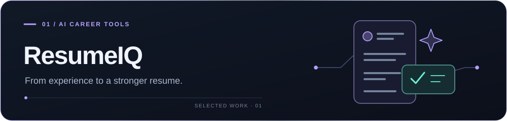
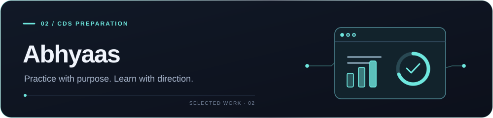
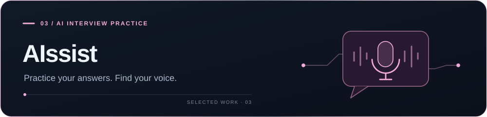
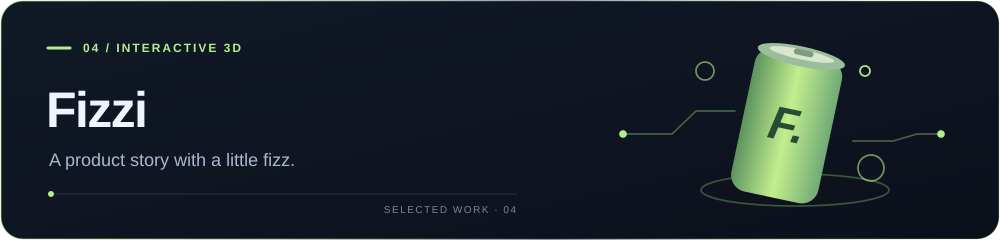

<picture>
  <source media="(prefers-color-scheme: dark)" srcset="assets/hero-neon-dark.svg">
  
</picture>

 

  
  &nbsp;
  
  &nbsp;
  

 

## Interfaces with personality. Engineering with purpose.

I'm **Kajal Tiwari**, a full-stack developer building AI-powered products and interactive web experiences. I work across the interface, APIs, and data layer—from the first screen to the workflows that make an application useful.

My projects bring together **React and Next.js**, **Node.js and Python**, and **applied AI**. I enjoy turning a complicated task into a clear sequence: understand a resume, practice for an exam, prepare for an interview, or explore a product in 3D.

## Selected work

A closer look at the products I build and the engineering behind them.

 

 

### ResumeIQ · AI resume workspace

A workspace that turns resume feedback into practical edits. Upload a PDF or DOCX, review ATS-focused feedback, strengthen individual bullet points, compare a job description, and export an updated PDF.

**Skills in practice:** document processing, structured AI responses, REST API design, authentication, and subscription billing integration.

`Next.js` `TypeScript` `Node.js` `Express` `MongoDB` `Gemini` `Stripe`

<strong>Inside the build — ResumeIQ</strong>

- **Document workflows:** PDF/DOCX parsing, resume validation, editable sections, and PDF generation with PDFKit.
- **Applied AI:** Gemini responses with JSON schemas, targeted bullet rewrites, job-description matching, and fallback analysis.
- **Backend & authentication:** Express APIs, Mongoose models, resource ownership checks, JWT authentication, rotating refresh tokens, and request limits.
- **Billing integration:** Stripe Checkout, a billing portal, and signed webhook handling.

 

[Explore code ↗](https://github.com/Kajaltiwari892/New-Resume-Ai) &nbsp; · &nbsp; [Open ResumeIQ ↗](https://new-resume-ai.vercel.app/)

 

 

 

### Abhyaas · A connected study workspace

A focused CDS preparation platform that brings topic practice, previous papers, AI doubt-solving, and progress tracking together. Saved attempts, a mistake notebook, and a daily study roadmap help learners pick up where they left off.

**Skills in practice:** retrieval-augmented generation (RAG), semantic search, Python APIs, relational data modelling, authentication, and progress visualization.

`Next.js` `TypeScript` `Python` `FastAPI` `PostgreSQL` `Gemini` `Qdrant`

<strong>Inside the build — Abhyaas</strong>

- **AI grounded in study material:** Gemini embeddings, Qdrant retrieval, source references, and a database search fallback.
- **Typed Python backend:** FastAPI endpoints, Pydantic validation, async SQLAlchemy, and Alembic migrations.
- **Persistent learning workflows:** saved practice results, notebook revision sessions, study plans, and daily check-ins.
- **Authentication & testing:** Google sign-in, JWT access tokens, refresh sessions, and backend tests for authentication, retrieval, and study workflows.
- **Interactive frontend:** Recharts progress views and a Three.js study companion.

 

[Explore Abhyaas ↗](https://abhyaas-two.vercel.app/)

 

 

 

### AIssist · Interview practice, out loud

Generate practice questions for a role, answer aloud, and revisit saved responses with AI feedback. The experience combines speech-to-text, a webcam practice view, and interview history in a personal dashboard.

**Skills in practice:** browser speech APIs, AI question generation, Clerk authentication, and relational schema design with Drizzle.

`Next.js` `TypeScript` `Gemini` `Clerk` `Drizzle ORM` `Neon PostgreSQL`

 

[Explore code ↗](https://github.com/Kajaltiwari892/Alssist)

 

 

 

### Fizzi · A product experience in motion

A playful showcase built around animated 3D soda cans. Scroll-driven scenes, responsive layouts, and Prismic-managed content turn a product page into an interactive story.

**Skills in practice:** 3D scene composition, scroll choreography, motion design, and CMS integration.

`Next.js` `TypeScript` `React Three Fiber` `Three.js` `GSAP` `Prismic`

 

[Explore code ↗](https://github.com/Kajaltiwari892/Fizzi) &nbsp; · &nbsp; [Open Fizzi ↗](https://fizzi-demo.vercel.app/)

 

## My toolkit

| Area | Technologies I use |
| :--- | :--- |
| **Languages & interfaces** | TypeScript · JavaScript · Python · React · Next.js · Tailwind CSS · shadcn/ui |
| **APIs & authentication** | Node.js · Express · FastAPI · Pydantic · JWT · Clerk |
| **Data & persistence** | PostgreSQL · MongoDB · SQLAlchemy · Alembic · Drizzle · Mongoose |
| **AI & retrieval** | Gemini API · embeddings · Qdrant · RAG · structured AI responses |
| **Motion & visualization** | GSAP · Motion · Three.js · React Three Fiber · Recharts |
| **Product integrations** | Stripe · Prismic · PDFKit · Git · Vercel |

 

## What I care about when building

- **Useful AI:** feedback someone can act on, with source references or fallbacks where the workflow needs them.
- **Complete workflows:** authentication, saved progress, loading states, and error handling deserve as much attention as the main feature.
- **Intentional interaction:** motion should explain a transition, guide attention, or add personality to a well-structured interface.

 

 

Interested in AI products, learning tools, or a web experience with personality? [Let's connect.](https://www.linkedin.com/in/kajal-tiwari-46802034a/)
