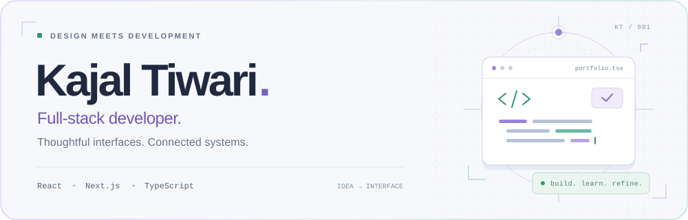
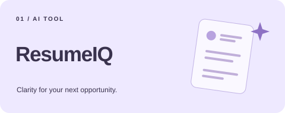
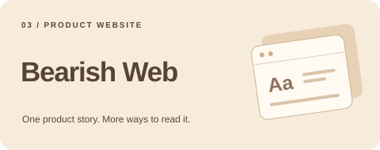
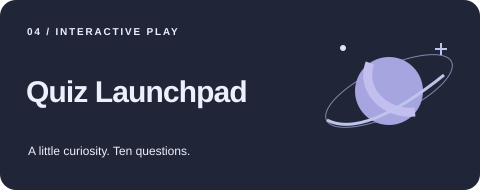
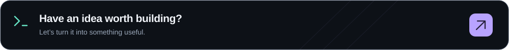

<picture>
  <source media="(prefers-color-scheme: dark)" srcset="assets/hero-dark.svg">
  
</picture>

  
  
  

## From the first interaction to the API behind it.

I'm **Kajal Tiwari**, a full-stack developer who cares about how a product works and how it feels. I build with React, Next.js, and TypeScript, then connect the interface to the data and services it needs.

My projects explore AI tools, expressive motion, and interactive 3D. I enjoy making complex flows easier to follow, writing maintainable code, and bringing a little personality to everyday interactions.

## Selected work

<table width="100%">
  <tr>
    <td width="50%" valign="top">
      
      
<strong>ResumeIQ</strong>

      
A workspace for reviewing resumes and improving weak bullet points. Includes job-description matching, interview preparation, and PDF export.

      
<code>Next.js</code> <code>Express</code> <code>MongoDB</code> <code>Gemini</code>

      
<a href="https://github.com/Kajaltiwari892/New-Resume-Ai">Explore code ↗</a> · <a href="https://new-resume-ai.vercel.app/">Live project ↗</a>

    </td>
    <td width="50%" valign="top">
      
      
<strong>Fizzi</strong>

      
A playful product showcase built around animated 3D soda cans. Scroll-driven scenes and Prismic-managed content bring the experience together.

      
<code>Next.js</code> <code>React Three Fiber</code> <code>GSAP</code> <code>Prismic</code>

      
<a href="https://github.com/Kajaltiwari892/Fizzi">Explore code ↗</a> · <a href="https://fizzi-demo.vercel.app/">Live project ↗</a>

    </td>
  </tr>
  <tr>
    <td width="50%" valign="top">
      
      
<strong>Bearish Web</strong>

      
A multilingual marketing website for Bearish OS. Animated feature stories, responsive layouts, and locale-based navigation support seven languages.

      
<code>Next.js</code> <code>TypeScript</code> <code>Tailwind CSS</code> <code>Framer Motion</code>

      
<a href="https://github.com/Kajaltiwari892/BearishWeb">Explore code ↗</a>

    </td>
    <td width="50%" valign="top">
      
      
<strong>Quiz Launchpad</strong>

      
A space-themed quiz with API-powered questions and a countdown timer. Animated results and celebratory feedback give each round a lively finish.

      
<code>React</code> <code>Vite</code> <code>Tailwind CSS</code> <code>Framer Motion</code>

      
<a href="https://github.com/Kajaltiwari892/Quiz-App">Explore code ↗</a> · <a href="https://quiz-app-woad-iota.vercel.app/">Live project ↗</a>

    </td>
  </tr>
</table>

## What I work with

| Area | Toolkit |
| :--- | :--- |
| **Interfaces** | React · Next.js · TypeScript · JavaScript · Tailwind CSS |
| **Motion & 3D** | GSAP · Motion / Framer Motion · Three.js · React Three Fiber |
| **Backend & data** | Node.js · Express · MongoDB · PostgreSQL · REST APIs |
| **Product tools** | Gemini API · Prismic · Clerk · Git · Vercel |

<strong>A little more about how I build</strong>

- I care about clear component structure and code that's easier to revisit.
- I use motion and feedback to make interactions easier to understand.
- I consider content, layout, and usability across different screen sizes.

 

Have an interesting interface, product idea, or open-source project in mind? [Let's connect.](https://www.linkedin.com/in/kajal-tiwari-46802034a/)
