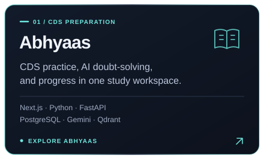
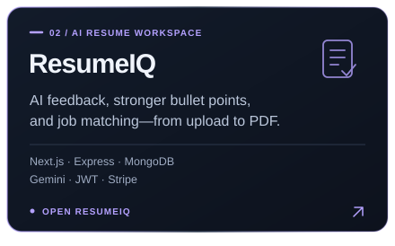
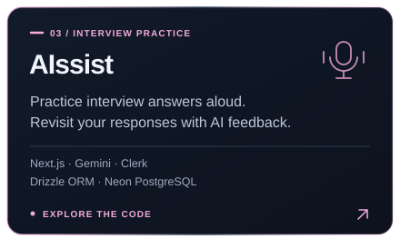
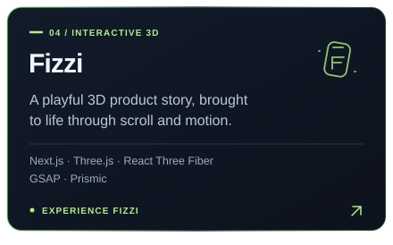

<picture>
  <source media="(prefers-color-scheme: dark)" srcset="assets/hero-neon-dark.svg">
  
</picture>

 

  
  &nbsp;
  
  &nbsp;
  

 

## Interfaces with personality. Engineering with purpose.

I'm **Kajal Tiwari**, a full-stack developer building AI-powered products and interactive web experiences. I work across the interface, APIs, and data layer—from the first screen to the workflows that make an application useful.

My projects bring together **React and Next.js**, **Node.js and Python**, and **applied AI**. I enjoy turning a complicated task into a clear sequence: understand a resume, practice for an exam, prepare for an interview, or explore a product in 3D.

### Beyond the code

I'm a curious girl who loves **painting** and learning about **cosmology**—from our solar system to the universe beyond. There's always another question I want to explore. **The curiosity never ends.**

## Selected work

  
  &nbsp;
  

  
  &nbsp;
  

<strong>Project links & engineering details</strong>

### Abhyaas

[Explore the app ↗](https://abhyaas-two.vercel.app/)

- **AI & retrieval:** Gemini embeddings, Qdrant semantic search, source references, and a database search fallback.
- **Backend & data:** Python, FastAPI, Pydantic, async SQLAlchemy, PostgreSQL, and Alembic migrations.
- **Product workflows:** authenticated study sessions, saved practice results, mistake notebooks, progress charts, and backend tests.

### ResumeIQ

[Open the app ↗](https://new-resume-ai.vercel.app/) · [Explore code ↗](https://github.com/Kajaltiwari892/New-Resume-Ai)

- **Documents & AI:** PDF/DOCX parsing, structured Gemini responses, targeted rewrites, job matching, and PDFKit exports.
- **Backend & authentication:** Express APIs, Mongoose, ownership checks, JWT, rotating refresh tokens, and request limits.
- **Billing integration:** Stripe Checkout, a billing portal, and signed webhooks.

### AIssist

[Explore code ↗](https://github.com/Kajaltiwari892/Alssist)

Browser speech APIs, Gemini interview questions and answer feedback, Clerk authentication, and saved sessions with Drizzle and Neon PostgreSQL.

### Fizzi

[Open the experience ↗](https://fizzi-demo.vercel.app/) · [Explore code ↗](https://github.com/Kajaltiwari892/Fizzi)

React Three Fiber scenes, GSAP scroll choreography, responsive layouts, and Prismic content integration.

 

## My toolkit

| Area | Technologies I use |
| :--- | :--- |
| **Languages & interfaces** | TypeScript · JavaScript · Python · React · Next.js · Tailwind CSS · shadcn/ui |
| **APIs & authentication** | Node.js · Express · FastAPI · Pydantic · JWT · Clerk |
| **Data & persistence** | PostgreSQL · MongoDB · SQLAlchemy · Alembic · Drizzle · Mongoose |
| **AI & retrieval** | Gemini API · embeddings · Qdrant · RAG · structured AI responses |
| **Motion & visualization** | GSAP · Motion · Three.js · React Three Fiber · Recharts |
| **Product integrations** | Stripe · Prismic · PDFKit · Git · Vercel |

 

## What I care about when building

- **Useful AI:** feedback someone can act on, with source references or fallbacks where the workflow needs them.
- **Complete workflows:** authentication, saved progress, loading states, and error handling deserve as much attention as the main feature.
- **Intentional interaction:** motion should explain a transition, guide attention, or add personality to a well-structured interface.

 

 

Interested in AI products, learning tools, or a web experience with personality? [Let's connect.](https://www.linkedin.com/in/kajal-tiwari-46802034a/)
